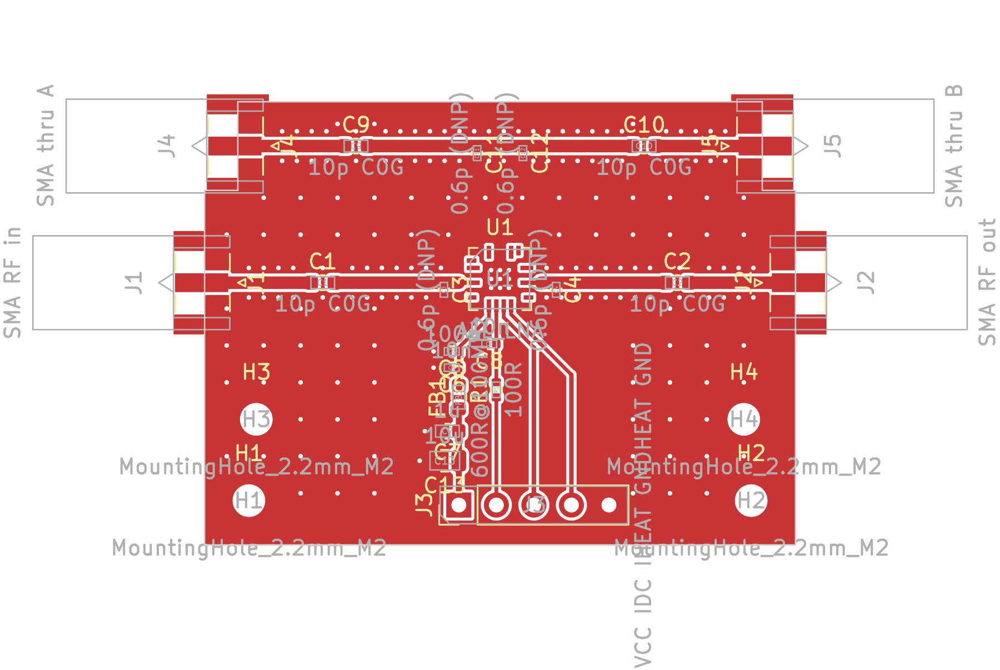
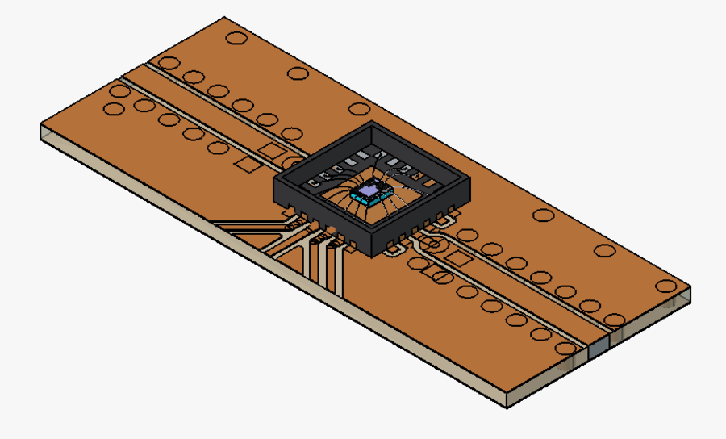

# ALL_LNA evaluation board — package, RF board, EM model

The IHP SG13G2 low-noise amplifier **ALL_LNA** in a **QFN-24 4x4**, on a
two-layer **RO4350B** board laid out for RF, and the RF path cut out as an
**openEMS** model with four ports — from GDS to a ready-to-run simulation
package.

| Board (KiCad, top) | EM model (`lna_rf_em.FCStd`) |
|---|---|
|  |  |

## Quick start: open the finished model

After cloning, open **`examples/lna_board/lna_rf_em.FCStd`** in FreeCAD
(1.1, with Package Studio installed). Everything is set; nothing has to be
generated first.

| Where | What you see |
|---|---|
| Model tree | `LNA eval board (RF path)`: the board cut-out with the package on U1, the six RF die pads, `EM settings` |
| **EM simulation** panel | Solver openEMS, 0.5–6 GHz, mesh *coarse*, smallest cell 50 µm, chip metal *No metal* — read from the document |
| **Ports** panel | P1–P4, 50 Ω each, only P1 excited |
| **Materials** panel | copper, RO4350B (Dk 3.66, tan δ 0.0037), C194 leadframe, mould compound, AlSi1 wires, SG13G2 die stack |
| Property view, `EM settings` | the EM choices with a note why |
| Property view, chip `ALL_LNA` | `EmChipMetal = none`; `GdsPath`, `TechFolder` |

Then, in the EM panel: **Build model** → **Make simulation package**. The
package (~4.1 M cells, 0.7 GB RAM) is written to the folder set under
*7. Package*.

The chip's GDS and technology paths in the file are those of the computer
it was saved on; Package Studio finds `examples/data/ALL_LNA.gds` and
`technologies/IHP-SG13G2` in your clone by itself.

## Files

| File | What it is |
|---|---|
| `lna_rf_em.FCStd` | **the ready EM model** (RF cut-out, package, ports, EM settings), ~24 MB |
| `lna_pinlist.csv` | pin list: die pad → net → lead, ground-signal-ground at the RF pads |
| `kicad/` | KiCad project `lna_eval` (schematic, routed board, stackup, net classes, DRC rules, `LNAEval` library) |
| `make_package.py` | step 1: chip into the QFN-24, wires, LVS, bonding diagram, KiCad library |
| `make_board.py` | step 2: the KiCad project (run with KiCad's Python, `pcbnew`) |
| `make_assembly.py` | step 3: board back into FreeCAD, package on U1, RF cut-out, die pads, ports, EM settings; writes `lna_rf_em.FCStd` |
| `add_em_ports.py` | the ports for a cut-out made by hand in the GUI (FreeCAD Python console) |
| `out/` | generated, not in git (`.gitignore`) |

The chip itself is `examples/data/ALL_LNA.gds` (0.78 × 0.98 mm).

## Rebuild everything

```text
# FreeCAD Python console (View → Panels → Python console), from the repository root
exec(open(r"examples/lna_board/make_package.py").read())      # out/package/
exec(open(r"examples/lna_board/make_assembly.py").read())     # out/assembly/, lna_rf_em.FCStd

# KiCad's Python (only when the board changes)
python3 examples/lna_board/make_board.py                       # kicad/
```

`make_assembly.py` imports step 1 itself; `make_board.py` needs step 1's
`out/package/` (footprint, symbol, STEP). `freecadcmd` works too where it
finds the add-on's modules (`gdstk`); on Windows the GUI console is the
safe way.

The step-by-step guide with screenshots (GUI way, in German):
*Anleitung: LNA-Board in KiCad und Package Studio bis zur EM-Simulation*.

## Design

**Band.** Evaluated in S-band, 2.2–2.3 GHz (CubeSat downlink); board and
simulation to 6 GHz, because stability is decided outside the band too and
wire and lead resonances lie above it. Another band: change the frequency
in the EM panel; the lines are broadband.

**Package, by IHP's criteria.** IHP packages in QFN / open QFN, 24 to 64
pins (0.5 mm pitch), and offers StratEdge encapsulation for RF. The LNA
needs 16 wires; what matters is their length (~1 nH/mm, 1.5 nH is j21 Ω
at 2.3 GHz). So the smallest: QFN-24 4x4 (JEDEC MO-220). RF wires
1.54 / 1.57 mm, all 1.45–1.88 mm, LVS clean, MIL-STD-883 clean.

**Bonding, ground-signal-ground.** GND14–RFIN–GND15 on leads 3–4–5,
GND4–RFOUT–GND3 on 14–15–16: a return wire beside each RF wire (smaller
loop, less inductance, input and output shielded from each other). VTMP
and the calibration structures are not bonded.

**Board.**

| | |
|---|---|
| Material | RO4350B 0.508 mm, 2 layers, 35 µm Cu, ENIG; Dk 3.66 (design), tan δ 0.0037 |
| Layers | top: signals and ground pour; bottom: one unbroken ground (layer type *power*: nothing routed) |
| RF line | grounded coplanar waveguide, 50 Ω: w 0.85 mm, gap 0.20 mm, ε_eff 2.57 |
| Via fences | both sides, 1 mm off the line centre, 1 mm pitch |
| Connectors | edge-launch SMA, Samtec SMA-J-P-X-ST-EM1 (to 20 GHz) |
| DC blocks | 10 pF C0G 0603, 8 mm from the edge |
| Compensation | C3/C4 0402, not fitted, 1.55 mm before each RF land: ~L/Z0² = 0.6 pF makes the wire a 50 Ω low-pass section |
| Bias | from the lab: VCC via ferrite + 10 µF / 1 µF / 10 nF / 100 pF (at the lead); IDC via 100 Ω / 10 nF; heater pins straight to J3 |
| 2x-thru | J4–J5, 35.5 mm = twice SMA-to-land (17.75 mm), same parts: de-embedding with IEEE P370 |
| Checks | DRC 0 errors, 0 unconnected; schematic netlist = board |

## EM model

Cut-out (KiCad mm, y down): `110.5, 108.5, 129.5, 116` — U1, 7.25 mm of
each line (cut between two fence vias, ~14 substrate heights from the
package), fences and 3 mm of ground each side.

| Port | Where | Why |
|---|---|---|
| P1 | input line's cut end, line to bottom ground (0.508 mm) | fed as from the SMA; **excited** |
| P2 | on the die, RFIN to GND14, flat across the 44 µm gap | where the LNA's own S-parameters are defined |
| P3 | on the die, RFOUT to GND3 | as P2, output |
| P4 | output line's cut end | 50 Ω termination |

Die metal is left out (`EmChipMetal = none`): with the full TopMetal2 the
LNA's inductors would hang on P2/P3. Only the six RF pads are in, as
3 µm TopMetal2 blocks. The LNA enters later through its own S-parameters.

Mesh: 50 µm smallest cell in x/y; z is capped at 10 µm (half the copper)
by Package Studio, so the port ends and the 35 µm copper stay on mesh
lines.

## Run and evaluate

```powershell
cd <package>\simulation
$env:SETUP_ONLY="1"; python lna_rf_em_EM_openEMS.py      # build and show the model only
Remove-Item Env:SETUP_ONLY
python lna_rf_em_EM_openEMS.py                            # simulation_output\Sparameters.csv / .png
```

Switches: `OPENEMS_THREADS`, `END_DB=-40`, `MIN_CELL_UM=25` (finer x/y),
`MIN_CELL_Z_UM`.

| Result | Meaning |
|---|---|
| S21 | loss from the line end to the die pad — adds almost 1:1 to the LNA's noise figure |
| S11 | match of the input transition |
| S31, S41 | coupling from input to the die output / output line: the feedback around the LNA, i.e. its stability in the package |

Plausible: S21 a few tenths of a dB below 0 in band; S31/S41 well below.
S21 near −100 dB means a floating port (see below).

Next, in this order: convergence (`MIN_CELL_UM=25`, ~21 M cells, 3.4 GB;
ΔS21 < 0.1 dB in band → the coarse mesh is enough) · the full 4 × 4 matrix
(excite P1…P4 in turn) · cascade with the LNA's 2-port S-parameters
(Circuit model, ngspice or scikit-rf: gain, NF, K/µ) · C3/C4 swept
0.3–1 pF · VNA measurement de-embedded with the 2x-thru (P370).

## Limits of the model

- GND14 and GND15 are joined only through their wires and the board, not
  by the die's ground net; small, since P2 measures RFIN against GND14.
- P1/P4 are line-to-plane ports on a GCPW; the 7.25 mm of line to the land
  are part of the result and can be removed in the circuit model.
- FDTD resolves 3 µm pads and a 20 mm board at once; for the die region
  alone a FEM solver (Palace) is more accurate.

## Troubleshooting

| Symptom | Cause | Fix |
|---|---|---|
| S11 ≈ 0 dB, S21 ≈ −100 dB | port ends lost by a too coarse z mesh | write the package with this version, or `$env:MIN_CELL_Z_UM="10"` |
| LVS: *no die* | chip renamed / imported from a 7-Zip folder name | import `ALL_LNA.gds` directly |
| KiCad: `LNAEval:QFN-24_4x4_LNA` missing | `kicad/` copied without `LNAEval.pretty` | copy the whole folder |
| DRC: edge clearance at J1/J2/J4/J5 | `lna_eval.kicad_dru` missing | copy it along |
| `No module named 'gdstk'` | `freecadcmd` without the add-on's modules | run in the FreeCAD GUI console |
| `add_em_ports.py`: *has ports already* | run twice | reopen the cut-out without ports |
